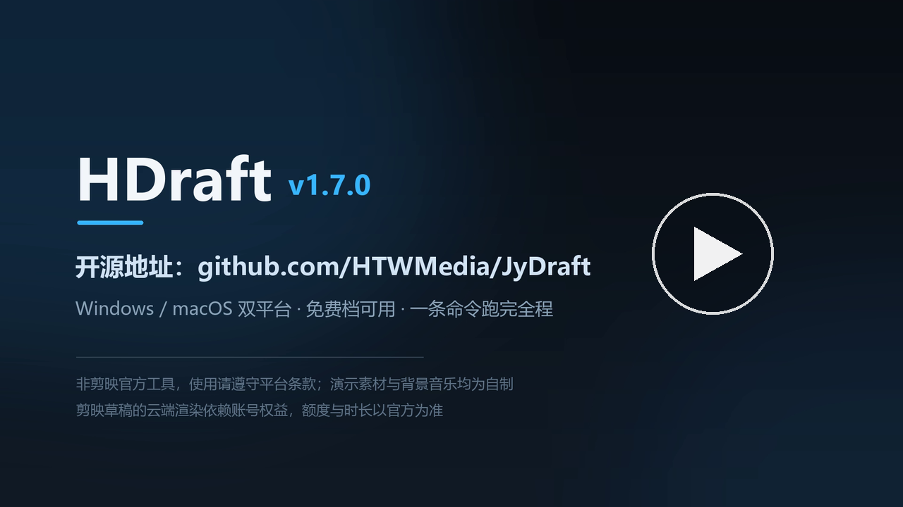
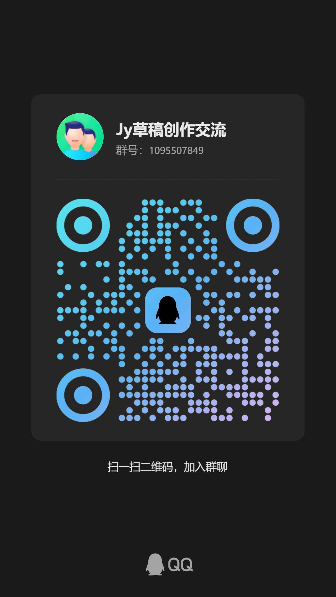

<div align="center">

# HDraft · 剪映草稿批量成片工具

**把「在剪映里一个个点导出」变成一条命令。**

草稿躺在剪映的工程目录里，导出却只能手动点、逐个等 —— HDraft 直接读取草稿工程，
自动解密、收集素材、上传云端并发渲染，成片回写到草稿所在目录。

[](https://github.com/HTWMedia/JyDraft/releases)
[](https://github.com/HTWMedia/JyDraft/releases)
[](https://github.com/HTWMedia/JyDraft/releases)

简体中文 ｜ [English](README_EN.md) ｜ [下载](https://github.com/HTWMedia/JyDraft/releases) ｜ [更新记录](#更新记录)

</div>

---

## 演示

<div align="center">

[](docs/demo/hdraft-demo-720p.mp4)

<sub>50 秒实录（720p）：改两行配置 → 一条命令启动 → 素材秒传跳过 → 云端渲染 → 成片回写草稿目录</sub>

</div>

---

## 它解决什么

剪映很适合做片，但**不适合批量出片**：

| 你现在怎么做 | 用 HDraft |
| --- | --- |
| 打开剪映 → 打开草稿 → 导出 → 等 → 下一个 | 写好草稿路径，一条命令全部跑完 |
| 一次只能导出一个，人得守着 | 多个草稿并发处理，跑完自动退出 |
| 导出吃满本机 CPU / 显卡，机器干不了别的 | 渲染在云端，本地只做打包上传，老机器也能跑 |
| 批量 / 定时 / 接进自己的系统几乎不可能 | 命令行 + HTTP 接口，天然可脚本化、可编排 |

**典型场景**：矩阵号日更（几十条同类草稿一次导出）、模板化混剪量产、
把出片接进自己的自动化流水线、在没有剪映的服务器 / 云主机上出片。

---

## 30 秒上手

### 1. 下载

到 [Releases](https://github.com/HTWMedia/JyDraft/releases) 下载对应平台的压缩包，解压即可用（无需安装）：

| 平台 | 文件 |
| --- | --- |
| Windows x64 | `HDraft_win-x64.zip` |
| macOS Intel | `HDraft_osx-x64.zip` |
| macOS Apple Silicon | `HDraft_osx-arm64.zip` |

> macOS 首次运行若提示「无法验证开发者」：`xattr -dr com.apple.quarantine /path/to/HDraft`，或在 Finder 里右键 → 打开。

### 2. 拿到 AuthKey

打开 <https://htwmedia.dpdns.org/Home/GetApiKey>，填入邮箱，Key 会发到邮箱。
AuthKey 只是一个**防滥用的准入闸口**，新用户注册即送 1 个月免费额度。

### 3. 告诉它草稿在哪

编辑 exe 同目录的 `config.ini`：

```ini
(!此行别删)  草稿路径：C:\Users\你\AppData\Local\JianyingPro\User Data\Projects\com.lveditor.draft\2月9日\draft_content.json
authKey:你的密钥
```

- 多个草稿用竖线 `|` 分隔；
- 也可以直接填**文件夹路径**，工具会自动扫描子目录下的所有草稿；
- 第一行前面的 `(!此行别删)` 是格式标记，请保留。

> 不想改配置文件？直接运行 `HDraft`，按提示输入 AuthKey 和草稿路径也一样能跑。

### 4. 运行

```bash
HDraft                      # 开始处理（读 config.ini）
HDraft --draft <路径>        # 临时指定草稿文件/目录，覆盖 config.ini 第一行
HDraft --jobs 2             # 同时处理几个草稿（默认按账号档位）
HDraft --no-pause           # 结束不等待按键，适合计划任务 / 管道
HDraft --help               # 查看帮助
```

处理过程中每一步都有提示，方便追踪；成片保存在**草稿所在目录**，文件名形如 `渲染视频20261030153012.mp4`。

#### 并发与额度

- 并发数**按账号档位自动决定**（免费 1、个人 2、工作室 4、企业 10），`--jobs N` 可以手动覆盖；
- 被服务端限流（429）时按服务端下发的 `Retry-After` 等待后重试；
- 额度在提交渲染时扣减，失败的任务不扣。

#### 中断续传

渲染提交后，taskId 会记录到程序同目录的 `hdraft_tasks.json`。程序被关闭、断网或下载失败后，
**重跑同一条命令不会重新提交渲染**：渲染中继续等待、已完成直接下载，不重复扣额度。
草稿内容改动后记录自动作废；加 `--no-resume` 可强制重新提交。

#### 退出码

| 退出码 | 含义 |
| --- | --- |
| 0 | 全部成功 |
| 1 | 有草稿失败 |
| 2 | 配置或用法错误 |
| 3 | AuthKey 验证失败 |
| 4 | 额度用完 |

结束时还会打印「成功 X，失败 Y，跳过 Z」，方便接进脚本和 CI。

---

## 它到底做了什么

```
草稿工程目录
   │  ① 读取 draft_content.json（加密的自动解密）
   │  ② 解析草稿引用的素材，收集视频 / 图片 / 音频
   │  ③ GIF 自动转 PNG 首帧
   ▼
上传素材到云端（本地只做打包上传，并发数按账号档位决定）
   ▼
④ 云端渲染：建任务 → 轮询进度
   ▼
⑤ 下载成片 → 写回草稿所在目录 → 清理临时文件
```

几个你可能会关心的细节：

- **加密草稿自动解密**：剪映 5.9 之后草稿是加密的，工具会自动处理，你不用管；
- **草稿不一定要来自剪映**：用代码生成 `draft_content.json`（见下）同样能渲染；
- **本机几乎不烧资源**：渲染在云端，上传完就可以关掉窗口等结果；
- **素材用完即清理**：渲染完成后云端临时素材会被删除，不做留存。

---

## 草稿从哪来

### ① 直接用剪映的工程草稿（最常见）

Windows 默认在：

```
C:\Users\<你>\AppData\Local\JianyingPro\User Data\Projects\com.lveditor.draft\<草稿名>\draft_content.json
```

不确定路径？在剪映里右键草稿 → 「打开草稿文件夹」即可。

### ② 用代码生成草稿（批量 / 模板化）

本仓库自带一个轻量的 C# 草稿生成库（`ScriptFile.cs`、`VideoSegment.cs`、`AudioSegment.cs` …），
可以不打开剪映、直接用代码拼出一条片子。
仓库已包含 `JyDraft.csproj`，clone 后直接编译：

```bash
dotnet build      # 产出 JyDraft.dll，依赖已配好：Newtonsoft.Json / Microsoft.Extensions.Logging / MediaInfo.Wrapper.Core
```

```csharp
var script = new ScriptFile(1920, 1080);          // 画布尺寸
script.Content["id"] = draftId;

script.AddTrack(TrackTypeName.audio)
      .AddTrack(TrackTypeName.video)
      .AddTrack(TrackTypeName.text);

var audioSegment = new AudioSegment(
    new AudioMaterial(@"D:\assets\audio.mp3"),
    TimeUtil.Trange(0, "5s"),
    volume: 0.6f);
audioSegment.AddFade("1s", 0);                    // 淡入

var videoSegment = new VideoSegment(
    new VideoMaterial(@"D:\assets\video.mp4"),
    TimeUtil.Trange(0, "4.2s"));
videoSegment.AddAnimation(IntroType.斜切);        // 入场动画
videoSegment.AddTransition(TransitionType.信号故障); // 转场

var textSegment = new TextSegment(
    "据说 HDraft 效果还不错？",
    videoSegment.TargetTimerange,
    font: FontType.文轩体,
    style: new TextStyle(color: new[] { 1.0f, 1.0f, 0.0f }),
    clipSettings: new ClipSettings(transformY: -0.8f));

script.AddSegment(audioSegment)
      .AddSegment(videoSegment)
      .AddSegment(textSegment);

var json = script.Dumps();                        // 落盘即为 draft_content.json
```

支持的能力：音视频 / 图片 / GIF / 文本轨道与片段、关键帧、转场、动画、
字幕气泡、背景填充、滤镜与特效（`meta/` 目录下是各类效果的元数据）。

### ③ 从加密草稿解密出来

手里只有一个剪映加密的 `draft_content.json`，想看看里面写了什么 / 想改改再渲染，
用 `DecryptDraft` 接口（见下方「接进自己的系统」）解成明文 JSON。

---

## 接进自己的系统

CLI 已经能覆盖大部分场景；如果你要把出片能力嵌进自己的平台、做定时任务或 SaaS，
可以直接调 HTTP 接口。所有请求带请求头 `AuthKey: <你的 Key>`（`X-API-KEY` 亦可）。

### 简易流程：整体上传 ZIP

适合草稿包不大、想最少代码跑通的场景。

| 步骤 | 接口 | 说明 |
| --- | --- | --- |
| 1 | `POST /Home/UploadDraftPackage` | `multipart/form-data` 上传 ZIP（含 `draft_content.json` + 全部素材） |
| 2 | `POST /Home/StartRender?draftId={id}` | 启动渲染，返回 `taskId` |
| 3 | `GET /Home/GetStatus?taskId={id}` | 轮询 `Status` / `Progress` / `DownloadUrl` |

ZIP 结构（素材路径需与 JSON 中的引用一致）：

```
my_draft.zip
├── draft_content.json
├── video.mp4
├── audio.mp3
└── image.png
```

### 分块流程：素材逐个上传（HDraft 自己在用的方式）

适合大文件、需要秒传 / 断点续传 / 自己控制素材的场景。

```text
POST /Home/CreateAssetUpload   { md5, size, crc32, filename, file_type } → upload_id / space_id / token
      ↓ 直传字节流到云存储
POST /Home/CommitAssetUpload   { upload_id, space_id, md5, filename, size } → asset_id
      ↓ （所有素材重复上面两步）
POST /Home/SaveDraft           { draftJson, title, packageAssets } → draftId
POST /Home/RenderDraft         { draftId } → taskId
GET  /Home/GetStatus?taskId=…  → Status / Progress / DownloadUrl
```

`GetStatus` 返回示例：

```json
{ "Status": "completed", "Progress": 100, "DownloadUrl": "https://..." }
```

### 其他接口

| 接口 | 方法 | 说明 |
| --- | --- | --- |
| `/Home/GetApiKey` | GET | 网页申请 AuthKey（推荐） |
| `/auth/applykey?email=` | POST | 接口申请 AuthKey（邮件发送） |
| `/Home/DecryptDraft` | POST | `multipart/form-data` 上传加密草稿 JSON，返回明文 `draft_content` |

> 接口会持续演进，字段以实际返回为准；有疑问欢迎开 Issue。

---

## 常见问题

<details>
<summary><b>需要安装剪映吗？</b></summary>

不需要。HDraft 读的是剪映的草稿工程文件，渲染在云端完成，
所以可以在没装剪映的机器、甚至服务器上跑。
</details>

<details>
<summary><b>草稿路径怎么找？</b></summary>

剪映里右键草稿 → 「打开草稿文件夹」，里面的 `draft_content.json` 就是。
也可以直接把**文件夹路径**填进 `config.ini`，工具会扫描子目录。
</details>

<details>
<summary><b>提示素材找不到 / 渲染出来缺素材？</b></summary>

草稿引用的素材必须还在原位置、可访问。挪过素材或换过机器就容易出问题；
建议在剪映里打开一次草稿确认能正常预览，再交给 HDraft。
</details>

<details>
<summary><b>一次能并发多少？要跑多久？</b></summary>

并发数按账号档位自动决定（免费 1、个人 2、工作室 4、企业 10），可用 `--jobs N` 覆盖。
单条成片的耗时主要看云端队列和片长，
批量场景下整体通常远快于「人工逐个点导出」。
</details>

<details>
<summary><b>成片在哪？</b></summary>

在**草稿所在目录**下，文件名形如 `渲染视频20261030153012.mp4`。
</details>

<details>
<summary><b>我的素材会被留存吗？</b></summary>

不会长期留存。要做云端渲染，草稿和素材会在渲染期间上传到剪映云与本项目服务端，
任务结束（成功或失败）后云端临时素材会被删除，本地临时文件也会清理。
涉及敏感或未公开的素材，请自行评估后再使用云端渲染。
</details>

<details>
<summary><b>渲染失败提示 200403 / 曲库音乐？</b></summary>

草稿里如果用了剪映「曲库」音乐（素材带 `music_id` / `effect_id`），云端渲染会返回
`200403 create render task failed`——曲库音乐的授权绑定在原账号上，渲染账号无权解析。
把这条音乐换成**本地音频文件**后重新导出即可。实测同一草稿仅移除曲库音乐轨道后渲染成功。
</details>

<details>
<summary><b>macOS 打开提示「无法验证开发者」？</b></summary>

二进制未做 Apple 签名/公证。执行 `xattr -dr com.apple.quarantine /path/to/HDraft`，
或在 Finder 里右键程序 → 打开。
</details>

## 错误码

| 码 | 含义 | 怎么办 |
| --- | --- | --- |
| 401 | AuthKey 缺失或无效 | 重新获取并填入 |
| 402 | 免费额度已用完 | 到平台充值后重试 |
| 400 | 请求参数有误 | 检查草稿包结构与字段 |
| 500 | 服务端内部错误 | 重试；持续出现请开 Issue |

---

## 更新记录

当前版本 **[v1.7.0](https://github.com/HTWMedia/JyDraft/releases/tag/v1.7.0)**（2026-10-30），
完整历史与各版本安装包见 [Releases](https://github.com/HTWMedia/JyDraft/releases)。

<details open>
<summary><b>v1.7.0 · 额度安全与可自动化</b></summary>

**新增**

- **按账号档位自动并发**：启动时读取账号档位（免费 1 / 个人 2 / 工作室 4 / 企业 10），
  不再固定 4 路，免费账号不会连环触发 429；`--jobs N` 可手动覆盖；
- **遵守 429 `Retry-After`**：按服务端下发的等待时长重试（缺省 5 秒，最长 120 秒）；
- **渲染任务断点续传**：taskId 记录在 `hdraft_tasks.json`，重跑先查状态，
  渲染中继续等待、已完成直接下载，不重复上传素材、不重复提交、不重复扣额度；
- **退出码与非交互参数**：`--draft` / `--jobs` / `--no-pause` / `--help`，
  退出码 0–4 区分成功、失败、用法错误、认证失败、额度用完，便于接计划任务与 CI。

**改进**

- 草稿路径自动 trim 并去重，同一草稿只处理一次；
- 需要输入但 stdin 被重定向时直接报错，不再挂起等待。

**已知限制**

- 使用剪映「曲库」音乐（`music_id` / `effect_id`）的草稿会返回 `200403`，
  换成同目录的本地音频文件即可正常渲染。

</details>

<details>
<summary><b>v1.6.0 · 新版剪映草稿支持</b></summary>

- 支持新版剪映 `Timelines` 目录结构；解密失败时自动生成 `draft_content.plain.json` 便于排查；
- 修复渲染轮询被网络抖动误判失败：改为持续轮询，连续 10 次失败才判定；
- 移除沿用剪映 Cookie 的隐式行为，失败时改为明确提示，不再静默污染账号。

</details>

---

## 相关项目

- [HTWMedia/HTWClient](https://github.com/HTWMedia/HTWClient) —— 开源桌面客户端，
  覆盖选题 → 创作 → 剪辑 → 多平台发布的完整链路。只想批量导出草稿用 HDraft，
  要完整工作台就用 HTWClient。

## 参与

Issue 和 PR 都欢迎。本仓库的草稿生成库源码在根目录，
如果你发现了新的草稿字段、新的效果参数，欢迎补充进 `meta/`。

## 交流

对剪映 / CapCut 草稿结构、加解密原理、自动化渲染流程感兴趣，欢迎进群聊：



> 仅用于技术交流与经验分享，请勿发布广告。

## 许可证

本仓库代码以 [Apache License 2.0](LICENSE) 开源。

## 免责声明

- 本项目为独立开发的第三方工具，与剪映 / CapCut 的运营方无任何关联，未获其授权或背书。
- 使用本工具导出的草稿、素材与成片，请自行确保拥有相应的使用权，并遵守剪映 / CapCut
  用户协议及所在地法律法规；因使用产生的账号风险与法律责任由使用者自行承担。
- 草稿中的曲库音乐（`music_id` / `effect_id` 指向剪映曲库的素材）授权绑定原账号，
  换账号渲染可能返回 `200403`，请改用本地音频或在目标账号重新添加。
